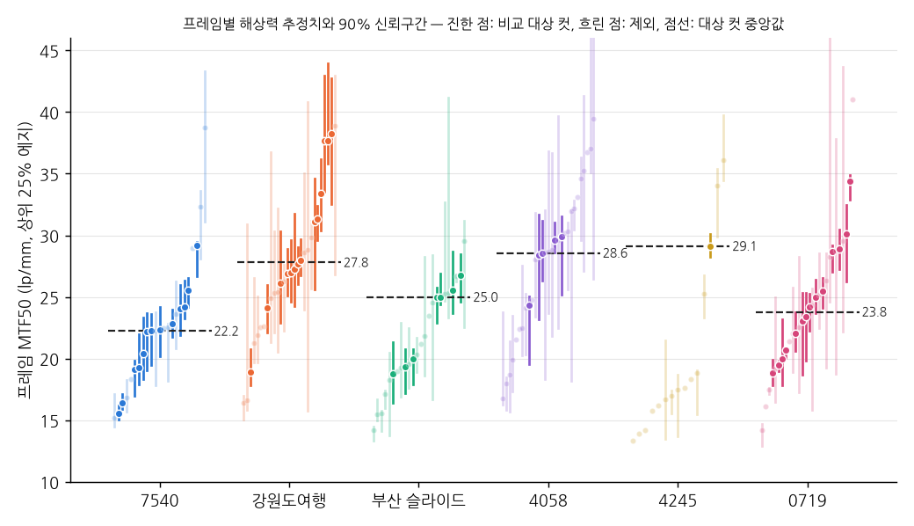
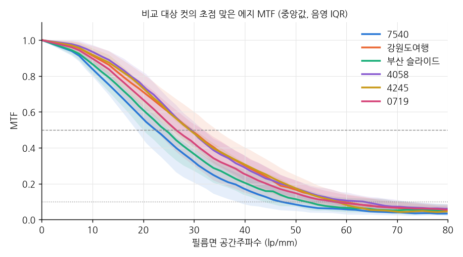
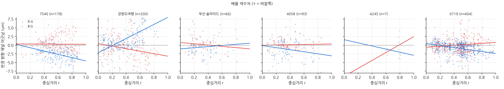
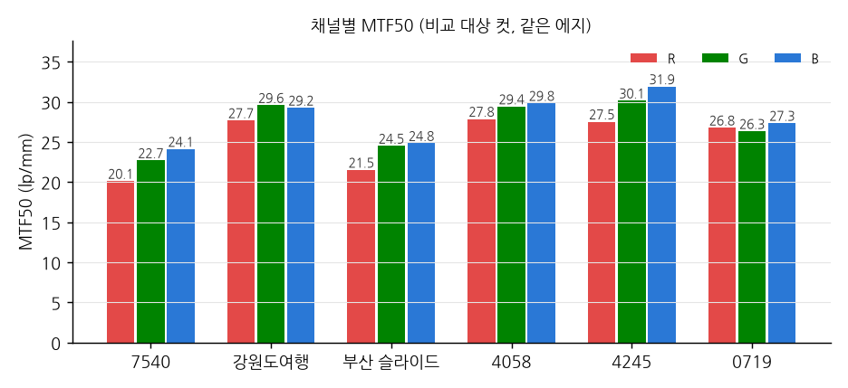

# 필름 스캔 해상력·수차 비교

2026-11-01 · 대상: `7540-먼지제거`, `이윤진-강원도여행-먼지제거`, `부산슬라이드사진`, `이윤진_예전것재스캔/{4058,4245,0719}` (Noritsu 6774×4492 JPEG)
렌즈: 7540·4058·4245·0719 = Helios-44M-4 58mm f/2 · 강원도여행 = Meyer-Optik Lydith 30mm f/3.5 + Pentacon 50mm f/1.8 auto
단위: 필름면 lp/mm. 36 mm 폭 기준 188.2 px/mm이고, 스캔 나이퀴스트는 94 lp/mm입니다.

## 결론

| | 7540 | 강원도여행 | 부산 슬라이드 | 4058 | 4245 | 0719 |
|---|---|---|---|---|---|---|
| 비교 대상 컷 수 | 13 | 14 | 7 | 5 | 1 | 14 |
| **대상 컷 MTF50 중앙값** | **22.2** | **27.8** | **25.0** | **28.6** | (29.1) | **23.8** |
| 대상 컷 IQR | 19.2–24.1 | 26.9–32.9 | 19.7–25.3 | 28.4–29.6 | – | 21.0–27.9 |
| 최상위 3컷 평균 | 26.3 | 37.9 | 25.8 | 29.4 | (29.1) | 31.1 |
| MTF @20 / @30 / @40 lp/mm | 0.56 / 0.32 / 0.17 | 0.71 / 0.49 / 0.30 | 0.61 / 0.36 / 0.20 | 0.74 / 0.48 / 0.29 | 0.73 / 0.48 / 0.31 | 0.67 / 0.42 / 0.25 |
| MTF10 | 47 | 59 | 52 | 63 | 58 | 57 |

- 같은 기준으로 고른 컷끼리 비교했을 때 순위는 **4058 ≈ 강원도 > 부산 ≈ 0719 ≈ 7540**입니다(4245는 대상 컷 1장이라 제외). 대상 컷 중앙값 기준으로 강원도는 7540보다 약 25% 높습니다.
- 롤 안에서의 컷 간 편차가 롤 사이 차이만큼 큽니다. 7540의 최상위 컷 `75420005`(29.2)는 강원도의 중간 컷들(26.9–31.3)과 같은 수준입니다.
- 차이가 확실하게 갈리는 건 최상위권입니다. 강원도의 상위 3컷(37.7–38.2, 신뢰구간 하한 32.5–35.8)은 다른 롤의 어떤 대상 컷보다 높습니다. Helios 최고 컷은 0719의 `07190014`(34.4)입니다.
- Helios-44M-4로 찍은 네 롤(7540, 4058, 4245, 0719)을 합치면 중앙값 24.1로, 강원도 두 렌즈(27.8)보다 약 13% 낮습니다. 같은 렌즈의 롤 간 편차(22.2–28.6)가 렌즈 간 차이보다 큽니다([아래 절](#helios-44m-4-네-롤-7540--4058--4245--0719)).

## 7540 (Helios 58mm) vs 강원도 (Lydith 30mm + Pentacon 50mm): 얼마나 밀리나

| | 7540 | 강원도 | 7540 / 강원도 |
|---|---|---|---|
| 대상 컷 중앙값 | 22.2 | 27.8 | 0.80 |
| 대상 컷 중간 50% | 19.2–24.1 | 26.9–32.9 | 범위가 겹치지 않음 |
| 상위 3컷 평균 | 26.3 | 37.9 | 0.69 |
| 30 lp/mm에서의 MTF | 0.32 | 0.49 | 0.65 |

- 7540은 강원도보다 **대체로 약 20% 낮습니다.** 두 롤의 중간 50% 범위가 겹치지 않으므로, 롤 전체에서 일관되게 낮은 겁니다.
- 7540의 중간 수준 컷은 강원도의 하위권 컷과 비슷합니다. 7540 최고 컷 `75420005`(29.2)가 강원도의 중간 수준입니다.
- 격차가 가장 큰 곳은 최상위권(약 30%)입니다. 강원도 상위 3컷(37–38)에는 7540의 어떤 컷도 닿지 않습니다.
- 가장 무른 7547 묶음 3컷을 빼도 7540 중앙값은 22.6이라 결론은 같습니다.
- 약 20% 차이는 100% 확대나 큰 인화에서 보이고, 폰이나 웹 크기에서는 구분하기 어렵습니다.
- 이 비교만으로는 렌즈 차이와 촬영 조건 차이를 분리할 수 없습니다. 같은 Helios로 찍은 다른 세 롤과 비교한 다음 절을 보면 7540만의 약 20% 차이는 과장된 값이고, 네 롤 합산으로는 약 13%입니다.

## Helios-44M-4 네 롤: 7540 · 4058 · 4245 · 0719

7540(서울) 외에 `이윤진_예전것재스캔`의 4058(제주), 4245(바닷가), 0719(벚꽃·사찰)도 Helios-44M-4 58mm f/2로 찍은 롤입니다.
스캔 규격(6774×4492)과 분석 기준은 모두 같습니다.

| | 7540 (서울) | 4058 (제주) | 4245 (바닷가) | 0719 (벚꽃·사찰) | **Helios 4롤 합산** | 강원도 (Lydith + Pentacon) |
|---|---|---|---|---|---|---|
| 비교 대상 컷 / 측정된 컷 | 13 / 23 | 5 / 29 | 1 / 15 | 14 / 28 | **33** | 14 / 28 |
| 대상 컷 중앙값 | 22.2 | 28.6 | (29.1, 1컷) | 23.8 | **24.1** | 27.8 |
| 대상 컷 중간 50% | 19.2–24.1 | 28.4–29.6 | – | 21.0–27.9 | **20.7–28.6** | 26.9–32.9 |
| 상위 3컷 | 29.2 · 25.6 · 24.2 | 29.9 · 29.6 · 28.6 | 29.1 | **34.4** · 30.1 · 28.9 | 34.4 · 30.1 · 29.9 | 38.2 · 37.7 · 37.7 |
| MTF10 | 47 | 63 | – | 57 | | 59 |
| 청색 배율 색수차 @모서리 (µm) | −4.6 ± 0.8 | −3.1 ± 1.7 | (n=7) | −2.4 ± 0.4 | 모두 안쪽 | +6.7 ± 0.9 |
| Meridional / Sagittal (r ≥ 0.45) | −13% (n=49/48) | −12% (n=7/10) | (n=4/2) | **+6%** (n=79/44) | 일관되지 않음 | −4% |
| 대상 컷 밝기 중앙값 (0–255) | 110 | 154 | 165 | 143 | | 130 |
| 검증 통과율 | 10% | 21% | 3% | 25% | | 32% |

**4058 대상 컷**: `40580021` 29.9 (25.2–31.6, 17) 거리 풍경 · `40580012` 29.6 (28.6–31.1, 98) 항구의 배 · `40580028` 28.6 (26.3–31.2, 46) 자갈밭 ·
`40580020` 28.4 (23.2–31.7, 21) 수국 근접 · `40580026` 24.3 (19.6–25.1, 13) 덩굴잎

**4245 대상 컷**: `42450033` 29.1 (28.3–30.1, 17) 해변과 건물. 롤 대부분이 바다, 파도, 모래라 곧은 경계가 거의 없어서 나머지 컷은 측정 신뢰도 기준을 넘지 못했습니다.

**0719 상위 3컷**: `07190014` **34.4** (32.9–34.9, 183) 기와지붕 · `07190012` 30.1 (26.2–32.4, 29) 단청과 전각 · `07190023` 28.9 (27.3–30.5, 159) 천장 단청

**롤 간 편차가 큽니다.** 같은 렌즈인데 대상 컷 중앙값이 22.2(7540)부터 28.6(4058)까지 퍼져 있습니다.
- 4058은 7540보다 높고, 이 차이는 통계적으로 뚜렷합니다(Mann–Whitney p = 0.003).
- 0719는 7540과 구분되지 않습니다(p = 0.15).
- 4245는 대상 컷이 1장뿐이라 롤 단위로 판단할 수 없습니다.

**Helios 대 강원도 렌즈**
- 네 롤을 합친 Helios 33컷의 중앙값은 24.1이고, 강원도 두 렌즈 합산은 27.8입니다. Helios가 **약 13% 낮고**, 이 차이는 통계적으로 뚜렷합니다(p = 0.005).
- 7540만 놓고 본 약 20% 차이는 롤 하나의 조건 때문에 과장된 값입니다. 반대로 4058만 놓고 보면 차이가 거의 없어 보이는데, 이것도 롤 하나의 결과입니다.

**최상위 컷**
- 0719의 `07190014`가 34.4(CI 32.9–34.9, 에지 183개)로, Helios 컷도 **34 이상까지** 나옵니다. Lydith 2위 컷(33.4)과 비슷한 수준입니다.
- 앞에서 쓴 "Helios는 약 30에서 더 오르지 않는다"는 표현은 7540과 4058만 본 결과였고, 0719 결과로 정정합니다.
- 그래도 강원도 상위 3컷(37.7–38.2)에 닿은 Helios 컷은 없습니다.

**렌즈 지문**
- 청색 배율 색수차는 측정 표본이 충분한 세 롤(7540, 4058, 0719) 모두 안쪽 방향(−2.4 ~ −4.6 µm)입니다. 강원도 두 렌즈와는 반대여서, 이 패턴은 렌즈 지문으로 쓸 수 있습니다.
- 반면 meridional 방향이 낮은 경향은 7540과 4058에만 있고, 0719에서는 오히려 meridional이 6% 높습니다. 그래서 이 경향은 렌즈 고유 특성이 아니라 롤별 피사체 방향이나 초점 차이로 봅니다.

**스캔 차이 여부**: 7540과 4058의 입자 노이즈 스펙트럼을 비교했습니다(밝기 120–200, 7540 25,581개·4058 1,455개 패치, 저주파 대비 상대값). 0.2 c/px에서 0.33 vs 0.39, 0.4 c/px에서 0.18 vs 0.14로 형태가 거의 같아서, 두 롤의 차이는 스캔 때문이 아닙니다.

**7540이 낮은 원인**은 여전히 확정할 수 없습니다.
- 7540은 유리 커튼월이 많고 노출이 어둡습니다(밝기 110).
- 0719는 불투명한 기와·단청 경계가 많고 노출도 적정(143)인데, 중앙값은 23.8로 7540과 큰 차이가 없습니다.
- 따라서 피사체와 노출만으로는 설명이 부족하고, 조리개·초점·흔들림 같은 촬영 조건이 롤마다 달랐을 가능성이 큽니다. 이 값들은 기록이 없습니다.

**정리**
- Helios-44M-4의 대표 컷 해상력은 약 24 lp/mm이고, 롤에 따라 22–29입니다. 강원도 두 렌즈(약 28)보다 대체로 10–15% 낮습니다.
- 잘 나온 컷은 30–34까지 나옵니다.
- 렌즈 단독 우열로 확정하려면 같은 필름·조리개·피사체로 번갈아 찍어 비교해야 합니다.

## 렌즈별 분류와 모니터 권장 해상도

| 롤 | 렌즈 |
|---|---|
| 7540 (서울) | **Helios-44M-4 58mm f/2** (단일 렌즈) |
| 4058 (제주), 4245 (바닷가), 0719 (벚꽃·사찰) | **Helios-44M-4 58mm f/2** (단일 렌즈) |
| 강원도여행 | **Meyer-Optik Lydith 30mm f/3.5** + **Pentacon 50mm f/1.8 auto** 혼용 |

### 강원도 롤의 컷별 렌즈 분류 (자체 분류)

스캔 파일에 EXIF가 없어서 컷별로 어느 렌즈를 썼는지는 기록이 없습니다.
그래서 **렌즈 고유의 배율 색수차 패턴**으로 분류하고, 화각을 보조 근거로 썼습니다.

이 방법이 통하는지는 단일 렌즈로 찍은 7540(Helios-44M-4)으로 먼저 확인했습니다.
측정 가능한 9컷 모두 청색 어긋남이 같은 방향(모서리에서 −2 ~ −9 µm)으로 나와서, 렌즈 지문으로 쓸 수 있다고 판단했습니다.

| 그룹 | 컷 | 청색 배율 색수차 (모서리) | 적색 | 화각 | 판정 |
|---|---|---|---|---|---|
| A | 01–19 (사찰, 해안) | **+8.0 µm** (바깥쪽, 컷별 +4 ~ +11) | −3.6 | 넓음 (01, 04, 05의 원근 왜곡이 큼) | **Lydith 30mm** |
| B | 20–36 (미술관, 조각) | +1.4 ~ +1.9 µm (컷별 −1 ~ +3) | −1.3 ~ −2.3 | 상대적으로 좁음 | **Pentacon 50mm** |

- 색수차를 측정할 수 있는 컷(01, 04, 05, 07, 08, 19 / 20, 21, 26–28, 35)에서는 두 그룹이 뚜렷하게 갈립니다.
- 측정할 경계가 없는 컷(바다 수평선, 야간 조명 등)은 촬영 순서로 추정했습니다. 렌즈 교체 지점은 19와 20 사이로 봤습니다.
- 17번은 색수차 측정이 불안정합니다(n=8, 오차 큼).
- 실제 컷별 렌즈가 이 분류와 다르면 `config.json`의 `lenses` 규칙만 고치고 `lens_report.py`를 다시 돌리면 됩니다.

### 렌즈별 해상력 (비교 대상 컷, MTF50 lp/mm)

| 렌즈 | 대상 컷 | 중앙값 | 중간 50% | 상위 3컷 평균 |
|---|---|---|---|---|
| Helios-44M-4 58mm f/2 (7540) | 13 | 22.2 | 19.2–24.1 | 26.3 |
| Helios-44M-4 58mm f/2 (4058) | 5 | 28.6 | 28.4–29.6 | 29.4 |
| Helios-44M-4 58mm f/2 (4245) | 1 | (29.1) | – | – |
| Helios-44M-4 58mm f/2 (0719) | 14 | 23.8 | 21.0–27.9 | 31.1 |
| **Helios-44M-4 58mm f/2 (4롤 합산)** | **33** | **24.1** | **20.7–28.6** | **31.5** |
| Meyer-Optik Lydith 30mm f/3.5 | 8 | 27.8 | 27.0–31.8 | 34.1 |
| Pentacon 50mm f/1.8 auto | 6 | 29.2 | 24.9–36.0 | 35.7 |

**렌즈별 상위 3컷** (프레임 MTF50 p75, 90% CI, 유효 에지 수)

| 렌즈 | 1위 | 2위 | 3위 |
|---|---|---|---|
| Helios-44M-4 58mm (7540) | `75420005` 29.2 (26.7–29.5, 9) | `75450005` 25.6 (24.2–26.5, 76) | `75440003` 24.2 (23.2–26.3, 30) |
| Helios-44M-4 58mm (4058) | `40580021` 29.9 (25.2–31.6, 17) | `40580012` 29.6 (28.6–31.1, 98) | `40580028` 28.6 (26.3–31.2, 46) |
| Helios-44M-4 58mm (4245) | `42450033` 29.1 (28.3–30.1, 17) | – | – |
| Helios-44M-4 58mm (0719) | `07190014` 34.4 (32.9–34.9, 183) | `07190012` 30.1 (26.2–32.4, 29) | `07190023` 28.9 (27.3–30.5, 159) |
| Lydith 30mm | `03000005` 37.7 (35.8–43.9, 48) | `03000007` 33.4 (30.4–36.2, 21) | `03000008` 31.3 (29.6–32.4, 44) |
| Pentacon 50mm | `03000027` 38.2 (32.5–42.7, 37) | `03000026` 37.7 (33.6–42.9, 25) | `03000028` 31.1 (25.6–34.6, 33) |

- Lydith 30mm와 Pentacon 50mm는 중앙값 차이가 1.4로 통계적으로 구분되지 않습니다.
- Pentacon의 상위 3컷은 모두 같은 붉은 조형물을 찍은 연속 컷이라 피사체가 겹칩니다.

### 모니터 해상도별 체감

**기준**: 3:2 사진을 16:9 모니터에 화면 꽉 차게(높이 맞춤) 띄운다고 가정했습니다.
필름 높이 24 mm가 모니터 세로 픽셀 수에 대응합니다.

| 모니터 | 세로 px | "선명" 필요 MTF50 (≥0.25 c/px) | "무난" 필요 MTF50 (≥0.20 c/px) |
|---|---|---|---|
| FHD | 1080 | 11.3 | 9.0 |
| QHD | 1440 | 15.0 | 12.0 |
| 4K | 2160 | 22.5 | 18.0 |
| 5K | 2880 | 30.0 | 24.0 |
| 6K | 3384 | 35.3 | 28.2 |
| 8K | 4320 | 45.0 | 36.0 |

(0.25 c/px는 샤프닝이 잘 된 디지털 사진을 100%로 볼 때의 전형적인 선명도입니다. 0.20 c/px는 약간 부드럽지만 거슬리지 않는 수준입니다.)

| 렌즈 | 대표 컷 (중앙값) 기준 | 잘 나온 컷 (상위 3컷) 기준 | **권장** |
|---|---|---|---|
| Helios-44M-4 58mm f/2 (7540) | QHD 선명, 4K 무난 (선명 기준 22.5에 0.3 모자람) | 4K 선명, 5K 무난 | **4K까지.** 5K부터는 대부분 컷이 물러 보임 |
| Helios-44M-4 58mm f/2 (4058) | 4K 선명, 6K 무난 (6K 무난 기준 28.2에 근접) | 4K 선명, 6K 무난 | **5K까지.** 같은 렌즈라도 롤 조건이 좋으면 한 단계 위 |
| Helios-44M-4 58mm f/2 (0719) | 4K 선명, 4K 무난 (5K 무난 기준 24.0에 0.2 모자람) | 5K 선명, 6K 무난 | **4K까지.** 잘 나온 컷은 5K 이상 |
| **Helios-44M-4 58mm f/2 (4롤 합산)** | 4K 선명, 5K 무난 | 5K 선명, 6K 무난 | **4K 권장, 5K 무난.** (4245는 대상 컷 1장이라 롤 단독 판정 생략) |
| Meyer-Optik Lydith 30mm f/3.5 | 4K 선명, 5K 무난 | 5K 선명, 6K 무난 | **5K까지.** 잘 나온 컷은 6K도 가능 |
| Pentacon 50mm f/1.8 auto | 4K 선명, 6K 무난 (5K 선명 기준 30에 근접) | 6K 선명 (경계선), 8K 미달 | **5K까지.** 잘 나온 컷은 6K도 가능 |

- 8K는 세 렌즈 모두(Helios 네 롤 포함) 대표 컷 기준으로 부족합니다.
- 스캔 파일의 세로 해상도(4492 px)는 8K(4320)를 넘으므로, 위 한계는 스캔이 아니라 촬영된 이미지에서 정해진 것입니다.
- 이 값은 렌즈 단독 성능이 아니라 촬영 조건(조리개, 초점, 흔들림)과 필름, 스캔이 합쳐진 결과입니다.

## 방법

1. **에지 검출**: LSD 선분 검출로 축에서 2.5–20° 기운 직선 경계를 이미지당 최대 400개 찾았습니다.
   어두운 컷과 창틀이 촘촘한 컷도 후보가 충분히 잡히도록 대비와 간격 기준을 낮췄습니다. 엄격한 검증은 다음 단계에서 합니다.
2. **슬랜티드 에지 SFR** (`scripts/slanted_edge_sfr.py`, ISO 12233 방식): 선형화한 휘도를 쓰고, 4배 오버샘플링한 ESF → LSF → FFT로 계산합니다.
   - 에지를 2차 곡선으로 피팅해서 곡면 건물의 곡률이 결과를 깎지 않게 했습니다. 피팅 잔차가 1 px를 넘으면 제외합니다.
   - 양쪽 면이 평탄하지 않거나 창 안에 두 번째 에지가 있으면 제외합니다.
   - 중복 검출은 하나만 남겼습니다. 보정본 `03000026-보정`과 `.webp`는 원본과 중복이라 뺐습니다.
   - 같은 에지에서 mtf_mapper와 비교했을 때 ±3% 안에서 일치합니다(1차 검증).
3. **노이즈 편향 제거**: CNR(대비 대 노이즈 비)이 낮은 에지는 입자 노이즈 때문에 MTF50이 높게 나옵니다.
   예를 들어 강원도에서 CNR 10 이하 에지는 49.9, 20–40 에지는 26.3입니다. 그래서 **CNR ≥ 20인 에지만** 썼습니다.
4. **인식률 차이 보정**: 롤마다 검증 통과율이 다릅니다(7540 10%, 강원도 32%, 부산 12%, 4058 21%, 4245 3%, 0719 25%).
   에지 수가 롤 평균을 좌우하지 않도록 **프레임 단위로 먼저 추정**하고, 그다음 프레임끼리 비교했습니다.
   - 프레임 추정치: 통과한 에지 MTF50의 상위 25% 지점(p75). 피사계심도 밖의 에지를 배제하려는 기준입니다.
   - 신뢰구간: 부트스트랩 2,000회로 90% 구간을 구했습니다.
5. **비교 대상 컷 선정** (선명도가 아니라 측정 신뢰도로만 골랐습니다):
   - 유효 에지 9개 이상
   - 90% 신뢰구간 폭이 추정치의 30% 이하
6. **수차 분석**: 대상 컷에서 초점 맞은 에지(프레임 내 상위 50%)만 썼습니다.

## 비교 대상 컷 (MTF50 p75, 90% CI, 유효 에지 수)

**7540**

| 컷 | MTF50 | 90% CI | 에지 |
|---|---|---|---|
| 75420005 | 29.2 | 26.7–29.5 | 9 |
| 75450005 | 25.6 | 24.2–26.5 | 76 |
| 75440003 | 24.2 | 23.2–26.3 | 30 |
| 75440002 | 24.1 | 21.9–25.9 | 11 |
| 75450006 | 22.8 | 21.7–24.0 | 66 |
| 75450001 | 22.4 | 20.2–24.2 | 19 |
| 75450003 | 22.2 | 19.5–23.6 | 18 |
| 75440006 | 22.2 | 19.0–23.7 | 22 |
| 75450004 | 20.4 | 18.4–23.3 | 16 |
| 75450002 | 19.2 | 17.9–22.0 | 19 |
| 75470004 | 19.2 | 17.0–19.8 | 10 |
| 75470003 | 16.4 | 15.9–17.1 | 33 |
| 75470002 | 15.6 | 15.0–16.2 | 51 |

**강원도여행**

| 컷 | MTF50 | 90% CI | 에지 |
|---|---|---|---|
| 03000027 | 38.2 | 32.5–42.7 | 37 |
| 03000005 | 37.7 | 35.8–43.9 | 48 |
| 03000026 | 37.7 | 33.6–42.9 | 25 |
| 03000007 | 33.4 | 30.4–36.2 | 21 |
| 03000008 | 31.3 | 29.6–32.4 | 44 |
| 03000028 | 31.1 | 25.6–34.6 | 33 |
| 03000015 | 28.0 | 26.7–29.7 | 27 |
| 03000014 | 27.7 | 26.0–29.1 | 28 |
| 03000029 | 27.2 | 24.3–31.8 | 12 |
| 03000001 | 27.0 | 24.6–29.6 | 16 |
| 03000004 | 26.9 | 25.1–28.9 | 46 |
| 03000017 | 26.1 | 22.9–30.4 | 27 |
| 03000034 | 24.2 | 22.1–26.0 | 12 |
| 03000021 | 18.9 | 17.9–20.7 | 70 |

**부산 슬라이드** (`KakaoTalk_20251210_172715771_` 생략)

| 컷 | MTF50 | 90% CI | 에지 |
|---|---|---|---|
| _09 | 26.8 | 24.6–28.5 | 47 |
| _23 | 25.5 | 23.7–28.7 | 24 |
| _11 | 25.0 | 24.4–26.9 | 9 |
| _18 | 25.0 | 22.9–25.8 | 9 |
| _16 | 20.0 | 17.9–20.7 | 14 |
| _14 | 19.4 | 17.2–20.8 | 32 |
| _15 | 18.8 | 16.4–21.3 | 12 |

**4058**

| 컷 | MTF50 | 90% CI | 에지 |
|---|---|---|---|
| 40580021 | 29.9 | 25.2–31.6 | 17 |
| 40580012 | 29.6 | 28.6–31.1 | 98 |
| 40580028 | 28.6 | 26.3–31.2 | 46 |
| 40580020 | 28.4 | 23.2–31.7 | 21 |
| 40580026 | 24.3 | 19.6–25.1 | 13 |

**4245**

| 컷 | MTF50 | 90% CI | 에지 |
|---|---|---|---|
| 42450033 | 29.1 | 28.3–30.1 | 17 |

**0719**

| 컷 | MTF50 | 90% CI | 에지 |
|---|---|---|---|
| 07190014 | 34.4 | 32.9–34.9 | 183 |
| 07190012 | 30.1 | 26.2–32.4 | 29 |
| 07190023 | 28.9 | 27.3–30.5 | 159 |
| 07190016 | 28.7 | 27.1–29.2 | 50 |
| 07190004 | 25.5 | 24.2–26.5 | 67 |
| 07190011 | 25.0 | 23.7–26.4 | 33 |
| 07190020 | 24.2 | 22.2–25.2 | 45 |
| 07190036 | 23.4 | 19.8–25.4 | 20 |
| 07190010 | 23.1 | 18.7–25.3 | 14 |
| 07190003 | 22.1 | 20.6–23.8 | 52 |
| 07190001 | 20.7 | 20.0–20.9 | 28 |
| 07190022 | 20.0 | 17.8–23.2 | 14 |
| 07190002 | 19.5 | 19.0–19.8 | 53 |
| 07190013 | 18.9 | 17.9–19.9 | 62 |

### 7540 최상위 기록

| 순위 | 컷 | MTF50 (p75) | 90% CI | 유효 에지 | 비고 |
|---|---|---|---|---|---|
| **1 (가장 날카로운 컷)** | **75420005** | **29.2** | 26.7–29.5 | 9 | 어두운 노출(밝기 41/255)에도 깨끗한 파사드 에지. 강원도 중간 컷들과 같은 수준 |
| 2 | 75450005 | 25.6 | 24.2–26.5 | 76 | 에지가 가장 많아 추정이 가장 안정적인 컷 |
| 3 | 75440003 | 24.2 | 23.2–26.3 | 30 | |

참고로 비교 대상에서 빠진 컷 두 장이 있습니다. 둘 다 유효 에지가 4개뿐이라 순위에 넣지 않았습니다.

- `75400001`: 38.7 (CI 31.1–43.3). 최고값 에지(43.3)를 육안으로 확인해 보니 경계를 따라 얇은 반사 하이라이트 선이 있어서 수치가 부풀었습니다.
- `75440005`: 32.4 (CI 28.1–33.6)

에지 하나 단위의 최고값(75450006의 49.6, 75450005의 45.1)도 육안으로 확인했습니다.
한쪽 면에 질감이 있거나 바로 옆에 가는 창틀이 붙어 있는 에지라서, 단일 값을 "최고 해상력"으로 보기는 어렵습니다.

7540 안에서는 묶음별 차이가 뚜렷합니다. 7542·7544·7545 묶음은 20–29이고, 7547 묶음(유리 커튼월 건물 3컷)은 15.6–19.2입니다.
부산은 노출이 적정한 컷(_09, _23, _11, _18)이 약 25이고, 밝기 195 이상인 하이라이트 위주 컷(_14, _15, _16)이 19–20입니다.

## 화면 위치별 해상력 (대상 컷의 초점 에지, 중앙값)

| | 중앙 r<0.3 | 중간 0.3–0.6 | 주변 r>0.6 |
|---|---|---|---|
| 7540 | 24.3 (n=15) | 22.6 (99) | 22.0 (86) |
| 강원도 | 28.0 (88) | 30.9 (111) | 29.5 (33) |
| 부산 | 24.7 (38) | 20.8 (37) | 17.4 (4) |
| 4058 | 29.5 (37) | 28.8 (43) | 29.1 (21) |
| 4245 | 30.1 (3) | – (0) | 28.8 (6) |
| 0719 | 24.9 (121) | 28.4 (180) | 26.8 (114) |

7540, 강원도, 4058, 0719는 주변부까지 해상력이 유지됩니다(중앙 대비 −10% 이내, 0719는 주변이 중앙보다 오히려 높음). 4245는 표본이 적습니다. 부산은 주변부 표본이 4개뿐이라 판단할 수 없습니다.

## 비점수차 (r ≥ 0.45)

| | Sagittal | Meridional | 차이 |
|---|---|---|---|
| 7540 | 22.3 (n=48) | 19.3 (49) | Meridional −13% |
| 강원도 | 29.6 (27) | 28.5 (26) | −4% |
| 부산 | 19.8 (10) | 20.7 (9) | 표본 부족 |
| 4058 | 29.3 (10) | 25.9 (7) | −12% (표본 적음) |
| 4245 | 29.9 (2) | 28.6 (4) | 표본 부족 |
| 0719 | 24.3 (44) | 25.8 (79) | **+6%** |

7540에서 meridional 방향이 약 13% 낮습니다. 표본이 양쪽 다 50개 가까이 있어 약한 비점수차로 볼 수 있습니다.
강원도는 차이가 거의 없습니다. 같은 Helios인 4058은 같은 방향(−12%, 표본 적음)이지만, 표본이 충분한 0719는 반대(+6%)입니다.
그래서 7540의 meridional 저하는 Helios 렌즈 고유의 비점수차라고 보기 어렵고, 롤별 피사체 방향이나 초점 차이일 가능성이 큽니다.

## 배율 색수차 (반경 방향 채널 어긋남, G 기준)

모서리(r=1) 외삽값, 단위 µm (±기울기 표준오차):

| | R−G | B−G | 해석 |
|---|---|---|---|
| 7540 | +0.2 ± 0.9 | **−4.6 ± 0.8** | B가 안쪽으로 약 0.9 px |
| 강원도 | −3.3 ± 1.4 | **+6.7 ± 0.9** | B가 바깥쪽으로 약 1.3 px |
| 부산 | −1.1 ± 1.4 | +0.5 ± 2.2 | 검출되지 않음 |
| 4058 | +0.3 ± 1.0 | **−3.1 ± 1.7** | B가 안쪽으로 약 0.6 px (7540과 같은 방향) |
| 4245 | (n=7) | (n=7) | 표본 부족 |
| 0719 | +0.8 ± 0.7 | **−2.4 ± 0.4** | B가 안쪽으로 약 0.5 px (7540과 같은 방향) |

7540과 강원도에서 청색 채널의 배율 색수차가 통계적으로 검출됩니다. 크기는 모서리에서 1 px 안팎이라 100% 확대에서 미세한 청·황 프린징이 보일 정도입니다.
두 롤의 부호가 반대(7540은 안쪽, 강원도는 바깥쪽)여서 **서로 다른 렌즈**였을 가능성이 높습니다.
같은 Helios-44M-4로 찍은 4058과 0719도 7540과 같은 방향(안쪽)이라, 이 패턴이 렌즈 지문이라는 점이 다른 롤에서도 확인됩니다.

## 채널별 MTF50 (대상 컷, 같은 에지)

| | R | G | B | R/G | B/G |
|---|---|---|---|---|---|
| 7540 | 20.1 | 22.7 | 24.1 | 0.92 | 1.05 |
| 강원도 | 27.7 | 29.6 | 29.2 | 0.96 | 1.00 |
| 부산 | 21.5 | 24.5 | 24.8 | 0.95 | 1.06 |
| 4058 | 27.8 | 29.4 | 29.8 | 0.94 | 1.01 |
| 4245 | 27.5 | 30.1 | 31.9 | 0.95 | 1.09 |
| 0719 | 26.8 | 26.3 | 27.3 | 0.98 | 1.02 |

0719를 뺀 다섯 롤에서 R 채널이 가장 무릅니다(−4 ~ −8%). 0719는 세 채널이 거의 같습니다(R/G 0.98). 컬러 필름에서 적감층이 맨 아래에 있는 구조와 일치합니다.
이 차이에서는 렌즈 축상 색수차를 따로 분리할 수 없습니다.

## 측정 범위

- 측정값은 렌즈 × 초점 × 흔들림 × 필름 × 스캐너 × 샤프닝 × JPEG가 모두 합쳐진 시스템 해상력입니다.
- 높은 대비 에지일수록 MTF50이 낮게 나오는 경향이 모든 롤에 공통으로 있습니다(할레이션이나 톤 커브 영향으로 추정).
  롤 간 비교에는 같은 CNR 기준을 적용했습니다.

## 파일

- `data/frames.csv` — 측정된 모든 프레임의 추정치, 신뢰구간, 에지 수, 인식률, 대상 컷 여부
- `data/edges.csv` — 에지별 측정값(CNR ≥ 20)
- `data/summary.json` — 롤 단위 집계 수치
- `data/lens_summary.json` — 렌즈별 집계, 상위 3컷, 모니터 판정
- `config.json` — 스캔 크기, 롤, 렌즈 분류 규칙, 선정 기준
- `scripts/` — `find_edges.py` (에지 후보), `slanted_edge_sfr.py` (SFR·채널·색수차), `analyze.py` (프레임 선정·수차·그림),
  `lens_report.py` (렌즈별 요약), `run_pipeline.sh` (전체 실행), `run_mtf_mapper.sh` (mtf_mapper 교차 검증),
  `build_mtf_mapper_cli.sh` (root 권한 없이 CLI 빌드)
